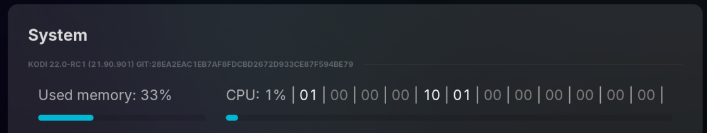
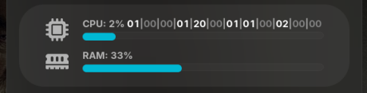

# CB1 PlayerProcessInfo (service.cb1.ppi)

An editable, customisable copy of the **cb1 PlayerProcessInfo panel** of the
[CroqueMr/libreelec-x86-DV](https://github.com/CroqueMr/libreelec-x86-DV) LibreELEC build, plus an
optional read-mostly web server for a compatible mobile app. English and Hungarian
(Magyar) user interface.

> Not affiliated with or endorsed by the LibreELEC, Kodi, CroqueMr or TinyPPI projects.
> "TinyPPI Mobile" is named only to say which app the web server is compatible with.
> Dolby, Dolby Vision and other format names are trademarks of their owners.

## What it does
- `template/cb1/*.xml` is the **editable source** (colours are `@@token@@` placeholders; labels are written in Hungarian and translated to English at build time, see `strings_en.py`).
- On start, and on every settings change, the service generates `media/cb1/*.xml` from the template.
- The items of `media/` are `mount --bind`-ed over `/usr/share/kodi/media`; they are unmounted when the add-on stops (disable, quit).
- **Do not edit `media/cb1/` directly** (it is overwritten). The `cb1-*.png` textures can be replaced directly.
- After editing a template: Settings → Advanced → "Regenerate panel now".
- **LibreELEC x86 with the CroqueMr Dolby Vision build only** (Kodi runs as root; needs the `cb1` panel and the `DV.*` window properties).

## Settings
- **Backgrounds:** main panel, bottom (meter) card, playback modes panel: colour + opacity; selected row colour.
- **Text colours:** main, values, labels, accent (green), warning (yellow), plus separate colours for column titles, column headers, section titles and values.
- **Advanced:** language (Automatic / English / Magyar), custom hex colours (RRGGBB or AARRGGBB), skin reload, regenerate, DV data refresh at playback start.
- **Mobile app:** optional web server (off by default), port, access token, control/library switch, optional MDBList API key.

## Info labels for skins
The fork fills these properties on the `playerprocessinfo` window:

    $INFO[Window(playerprocessinfo).Property(DV.L1PQ)]

Show the list of DV.* properties (86)

- `DV.AIL1`
- `DV.AIL3`
- `DV.AIModel`
- `DV.AdmissionReason`
- `DV.AppliedBlocks`
- `DV.AtomicResult`
- `DV.BL`
- `DV.BeforeAI`
- `DV.CLL`
- `DV.CM`
- `DV.CPU`
- `DV.Circuit`
- `DV.Committed`
- `DV.CreativeTrims`
- `DV.DecodedHLG`
- `DV.HdmiFormat`
- `DV.LldvRed`
- `DV.LldvGreen`
- `DV.LldvBlue`
- `DV.VideoUpscaler`
- `DV.Display`
- `DV.DisplayBlack`
- `DV.DroppedSkipped`
- `DV.EL`
- `DV.Engine`
- `DV.Enhanced`
- `DV.FEL`
- `DV.FELUpscaling`
- `DV.Fallback`
- `DV.GPUAvailable`
- `DV.GPURender`
- `DV.HDR10PlusAverage`
- `DV.HDR10PlusCurve`
- `DV.HDR10PlusMaxSCL`
- `DV.HDR10PlusSaturation`
- `DV.HDR10PlusSection`
- `DV.HDR10PlusTarget`
- `DV.HDR10Target`
- `DV.HDR10TargetLabel`
- `DV.HDR10TargetOrigin`
- `DV.L10`
- `DV.L11`
- `DV.L1Nits`
- `DV.L1PQ`
- `DV.L254`
- `DV.L255`
- `DV.L3`
- `DV.L4`
- `DV.L5`
- `DV.L9`
- `DV.Layers`
- `DV.Level`
- `DV.Mastering`
- `DV.Memory`
- `DV.MinimumLinkBits`
- `DV.Mode`
- `DV.OutputL1`
- `DV.OutputL2Targets`
- `DV.OutputL8Targets`
- `DV.OutputStage`
- `DV.ParsedBlocks`
- `DV.Precision`
- `DV.ProcessingVisible`
- `DV.Profile`
- `DV.ProfileDetail`
- `DV.RPU`
- `DV.Reconstruction`
- `DV.ReferenceWarning`
- `DV.RequestedPolicy`
- `DV.SignalIntent`
- `DV.SourceBits`
- `DV.SourceColour`
- `DV.SourceLight`
- `DV.SourceMastering`
- `DV.SourcePixelFormat`
- `DV.TVProfile`
- `DV.TransmittedBlocks`
- `DV.Transport`
- `DV.UsedHDR10PlusAverage`
- `DV.UsedHDR10PlusAvg`
- `DV.UsedHDR10PlusMax`
- `DV.UsedHDR10PlusMaxRGB`
- `DV.UsedHDRCLL`
- `DV.UsedHDRMax`
- `DV.UsedHDRMin`
- `DV.UsedHDRStatic`
- `DV.UsedL1Nits`
- `DV.UsedL1PQ`
- `DV.UsedL3`
- `DV.UsedL6Max`
- `DV.Version`

## CPU line for skins
The service publishes the per-core CPU load as ready-to-use **Window(Home) properties**, refreshed once a
second while the add-on runs. Kodi's own `System.CpuUsage` is one long text (`CPU #0: 2.0% #1: 2.0% ...`)
that is cut off on many screens; these properties are short and formatted:

| Property | Example | Use |
|---|---|---|
| `Window(Home).Property(cb1.cores)` | `\| 05 \| 00 \| 03 \| 11 \|` | per-core load, wide screens |
| `Window(Home).Property(cb1.coresc)` | `05\|00\|03\|11` | the same, compact, for narrow places |
| `Window(Home).Property(cb1.cpu)` | `14%` | average over all cores ("sum") |

Each core is two digits without a percent sign (100 % is shown as `99`). Busy cores are white, idle cores
(`00`) grey; the separator of the compact line is 50 % transparent. A core that Kodi reports as `nan%`
keeps its last value. The colours are the `CPU_*_COLOUR` constants at the top of `service.py`
(`AARRGGBB`, Kodi `[COLOR]` tags).

*(Screenshots: a custom skin, cropped.)*

### Using the values in a skin
Use them like any infolabel. The sum first, then the cores (a label of a skin XML):

    <label fallback="19055">$INFO[Window(Home).Property(cb1.cpu),CPU: ,]$INFO[Window(Home).Property(cb1.cores), ,]</label>

gives `CPU: 14% | 05 | 00 | 03 | 11 | ...`. For a narrow panel use the compact property:

    <label fallback="19055">$INFO[Window(Home).Property(cb1.cpu),CPU: ,]$INFO[Window(Home).Property(cb1.coresc), ,]</label>

Notes:
- In `$INFO[label,prefix,suffix]` the text between the commas is the prefix (`CPU: `).
- `fallback="19055"` shows Kodi's "No information available" when the property is empty (add-on not running).
- If the line is still cut off, let the label control reach past the progress bar: add `<right>-30</right>` to the `<control type="label">`. A 100 % average and 13 cores fit this way.
- Keep your progress bar on `<info>System.CPUUsage</info>`; that one needs a number.
- The properties only exist while this add-on runs. A skin using them without the add-on shows the fallback text.

## Mobile app (TinyPPI Mobile compatible)
Settings → **Mobile app** enables a web server (off by default) that implements the published
HTTP/JSON interface of the TinyPPI Mobile app ([CE-Repo/tinyppi-mobile](https://github.com/CE-Repo/tinyppi-mobile), MIT).
This is an independent implementation (no code, name or artwork of the TinyPPI add-on is used).
It offers: live panel, cover art/backgrounds, playback control, library, TV shows, resume, details.
Not offered: VS10 mode switching, event log/graphs, actor portraits. Control and library can be
switched off (the token is still required for reading). Source: `web.py`, `media.py`.

**More ratings:** enter a free [MDBList](https://mdblist.com) API key (mdblist.com → Preferences) under Mobile app.
The add-on queries by ID (IMDb/TMDb) and caches results for 7 days in the profile
(`addon_data/service.cb1.ppi/mdblist.json`). Ratings from TMDb Helper are still used for the playing title.
Use of the MDBList API is subject to MDBList's own terms; no key is bundled.

## Credits
- **CroqueMr** ([libreelec-x86-DV](https://github.com/CroqueMr/libreelec-x86-DV)): the LibreELEC Dolby Vision build, the cb1 Player information panel this add-on customises, and the kind permission to publish modified copies of the panel files under GPL-2.0-or-later (AVS Forum, 2026-11-15).
- **CE-Repo** ([tinyppi-mobile](https://github.com/CE-Repo/tinyppi-mobile), MIT): the mobile app whose published interface the web server is compatible with.
- **MDBList**: the optional multi-source ratings service.
- **Kodi** and **LibreELEC** teams.

## Licence
GPL-2.0-or-later, see `LICENSE` and `NOTICE.txt` (third-party and derived material).
